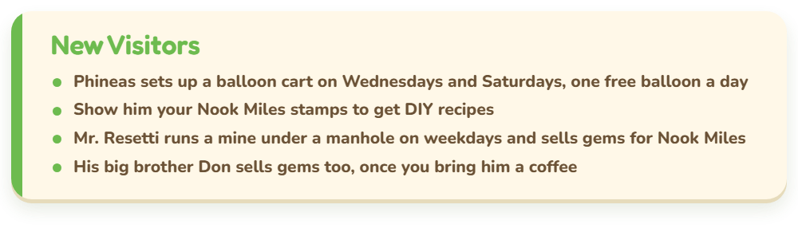
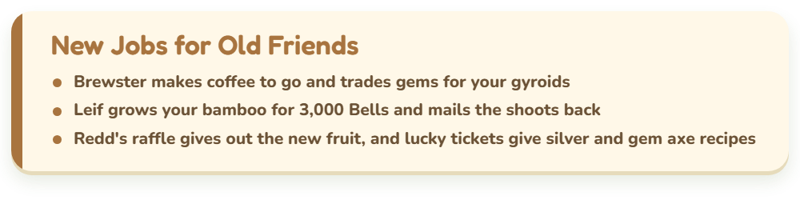
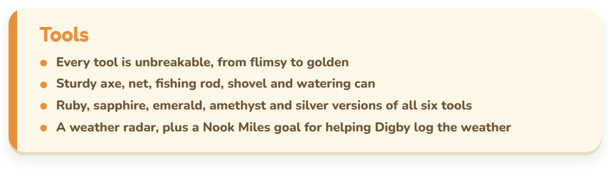
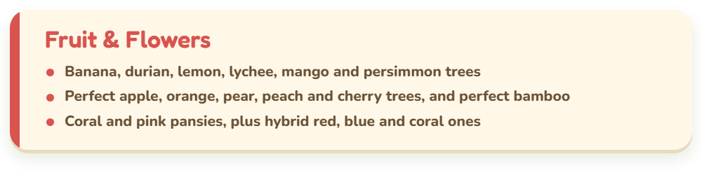
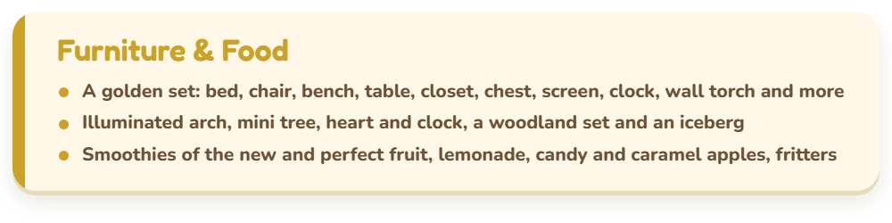
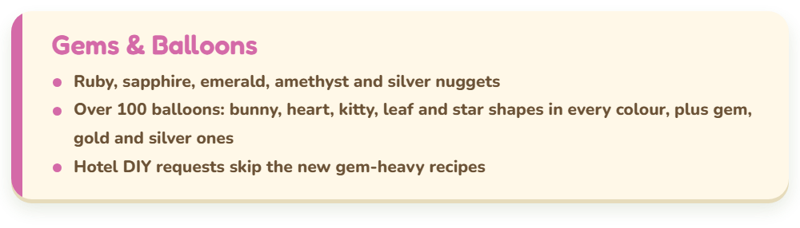
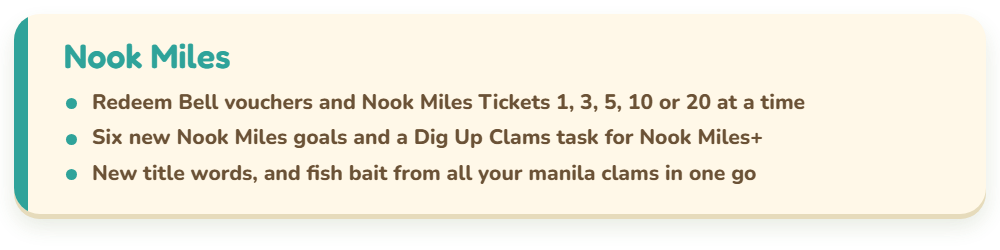
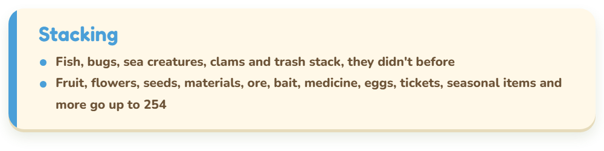
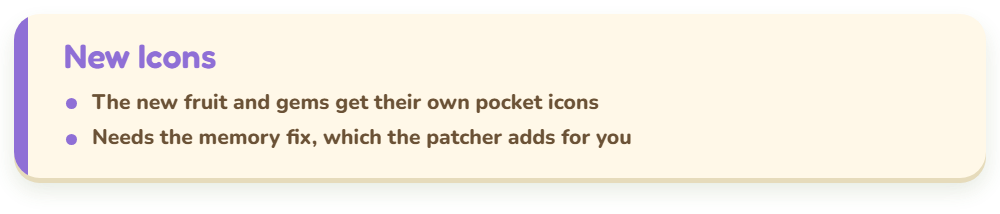
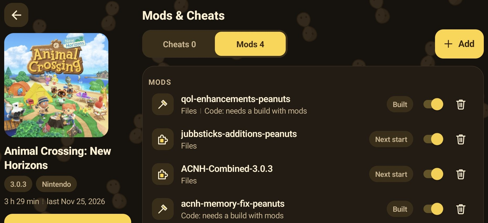

# Jubbsticks' Additions for Peanuts

[Jubbsticks' Additions](https://gamebanana.com/mods/579817), through dragonloverlord's [3.0.3 port](https://github.com/dragonloverlord/Unnofficial-Jubbsticks-Additions-Port), running on Peanuts Native on Android. The port crashes on Peanuts as is. The [patcher page](https://catmona.github.io/acnh-jubbsticks-peanuts/) fixes up your own download right in your browser, and can make [QoL Enhancements](https://github.com/catmona/acnh-qol-peanuts) at the same time.

> [!NOTE]
> **How this was made:** Claude (Anthropic's AI, through Claude Code) found why the port crashes, and wrote the patcher page, the build tools and the docs. I decided what to build and tested every build on my AYN Thor, but I haven't reviewed the code line by line, so assume any part of it may be AI-written.

## Features

All of this is Jubbsticks' and dragonloverlord's work, I just got it running on Peanuts. If something doesn't work, please open an issue here, not on their pages!

English only for now, and the original's two bananas per tree is left out (it needed an exefs patch that no longer exists).

## Install

1. Get `UJAP-BetaRelease-V002-Atmosphere.7z` from the [port's Releases](https://github.com/dragonloverlord/Unnofficial-Jubbsticks-Additions-Port/releases) (read the rules in its README first). Don't extract it.
   Want QoL Enhancements too? Also get **Main download (Modded Switch)** from its [GameBanana page](https://gamebanana.com/mods/727637).
2. Open the [patcher page](https://catmona.github.io/acnh-jubbsticks-peanuts/), pick your download(s) and hit **Make my Peanuts zips**.
3. Back up your save. In Peanuts, long-press ACNH, then go to **Mods & Cheats > Add > A file** and add each zip in the order the page lists them.
4. Peanuts rebuilds the game with the mods. That took about 5 minutes for me. Then hit Play.

One of the zips is a small memory fix. The new icons need it, so leave it ticked.

Using other mods too, like ACNH Combined? Add their zips in the page's "Using other mods too?" box, and install them after these.

My setup. QoL and ACNH Combined are optional.

## Troubleshooting

I run it on my AYN Thor with Peanuts Native 0.1.8, together with QoL and ACNH Combined.

With QoL too, set **Graphics > Frame rate cap** to **Game owned** until Peanuts merges a one-line fix ([QoL's README](https://github.com/catmona/acnh-qol-peanuts#troubleshooting) has the details). With that fix, all four zips play at 60 fps. I haven't tried this mod at 60 fps without QoL.

If the page says your download doesn't match, you need exactly `UJAP-BetaRelease-V002-Atmosphere.7z`.

## How it works

A few of the port's files come from an older version of the game and crash 3.0.3 on Peanuts. The page fixes those in your own download, so none of Jubbsticks' or the port's files are re-hosted here. Details are in [PORT.md](docs/PORT.md).

## Building it yourself

You need Python 3.12 with `zstandard`, the port's V0.0.2 release extracted, and the 3.0.3 romfs from your own copy of ACNH. The scripts in `tools/` have their usage at the top.

## Credits

Jubbsticks for the actual mod (go give it a like on [GameBanana](https://gamebanana.com/mods/579817)), dragonloverlord for the 3.0.3 port, and the Peanuts Native devs. The page bundles [fzstd](https://github.com/101arrowz/fzstd) (MIT).

Fan-made, not affiliated with Nintendo, Jubbsticks or dragonloverlord.

## License

The page and tools are GPL-2.0, same as [QoL for Peanuts](https://github.com/catmona/acnh-qol-peanuts). Jubbsticks' and the port's files aren't part of this repo, and the bundled fzstd keeps its MIT license.
