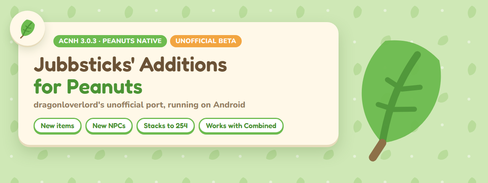
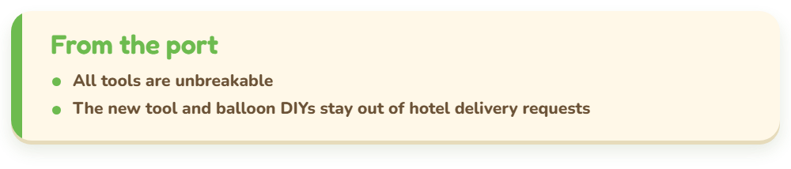
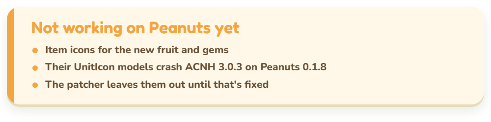

# Jubbsticks' Additions for Peanuts

A helper that turns dragonloverlord's [Unofficial Jubbsticks Additions Port](https://github.com/dragonloverlord/Unnofficial-Jubbsticks-Additions-Port) (UJAP-V0.0.2, ACNH 3.0.3) into a mod zip for Peanuts Native on Android.

The port's normal download doesn't run on Peanuts as is: some of its files are from the 2.x game and crash or hang 3.0.3 there. This repo has a [patcher page](https://catmona.github.io/acnh-jubbsticks-peanuts/) that fixes that up right in your browser. You give it the port's own download, and nothing gets uploaded.

> [!IMPORTANT]
> This is an **unofficial beta** of an unofficial port. Please don't ask Jubbsticks or dragonloverlord for help with this zip. If something breaks on Peanuts, open an issue here.

## Features

The mod is Jubbsticks' work, and the port to 3.0.x is dragonloverlord's. I only got it running on Peanuts.

## Install

1. Read the rules in the [port's README](https://github.com/dragonloverlord/Unnofficial-Jubbsticks-Additions-Port), then get `UJAP-BetaRelease-V002-Atmosphere.7z` from its [Releases](https://github.com/dragonloverlord/Unnofficial-Jubbsticks-Additions-Port/releases). Don't extract it.
2. Get `jub-port-patch.json` from the [latest release](https://github.com/catmona/acnh-jubbsticks-peanuts/releases/latest) here.
3. Open the [patcher page](https://catmona.github.io/acnh-jubbsticks-peanuts/), pick both files and hit **Make the Peanuts zip**.
4. Back up your save. In Peanuts, long-press ACNH to open its settings, then go to **Install mod… > Zip file** and pick `jubbsticks-additions-peanuts.zip`.
5. Peanuts rebuilds the game with the mod (about 5 minutes for me). Then start a new game.

Using other mods too? Install this one **first**, before any other ACNH mod. Peanuts gives each file to the first mod in the list that has it, and the first mod's size table limits every file. Pick your other mods' zips in the patcher's optional step 3, so the size table it makes covers their files too.

Other mods that replace the same item tables or the same two NPC flows (`SNPC_fox_11_Commune_Lorrery`, `SNPC_slo_02_Commune`) lose those files to this one.

Offline play only, with your own copy of the game.

## Status

This is early. Here's where it stands:

- The patch only fits port version `UJAP-V0.0.2`. dragonloverlord is still fixing item IDs in the port, so new versions will keep coming. The page refuses a newer download until I make a patch for it.
- This V0.0.2 build loads my island on my AYN Thor (Peanuts Native 0.1.8), together with QoL and ACNH Combined 3.0.3 (QoL first, then this mod, then Combined). It comes out byte for byte the same from the page as from my PC build.
- The EventFlow files (NPC dialogue flows) are in: the patch adds the port's 40 new flows and merges its flow list into the 3.0.3 one. I haven't checked yet that a new NPC flow plays: my test island is still at the tent stage, and the player can't cross its rivers yet.
- I haven't played far enough yet to check the new items in game.
- The item icons of the new fruit and gems are left out for now (see the card above and [PORT.md](docs/PORT.md)).
- With Peanuts' frame rate cap at 60 fps, the island load crashed on my Thor. With the cap at "Game owned", it loads. I'm looking into the 60 fps crash.

## About the AI part

Heads up: most of this repo (the patcher page, the build tools and the docs) was written by Claude through Claude Code. I decided what to build, picked between the options it came up with and ran the device tests on my Thor. I haven't gone through the code line by line. [PORT.md](docs/PORT.md) lists the checks that were run. Commits don't have a Claude co-author line, so assume any of it could be AI-written.

None of this gets sent to the port: please don't open issues or pull requests on the port's repo about this zip.

## How it works

The patch file has no files from the port or the original mod in it. It holds:

- the vanilla 3.0.3 message labels the port's `Message/` files lack: 79 item names in each `String` file and one line in each `TalkSNpc` file
- a resource size table: vanilla 3.0.3 plus the port's files

The page checks each message file it changes by SHA-256 before and after, so it only works on the exact V0.0.2 download. The port's item tables go in as they are, and its 25 UnitIcon models stay out. Details are in [PORT.md](docs/PORT.md).

## Building it yourself

You need Python 3.12 with `zstandard`, the port's V0.0.2 release extracted, and the 3.0.3 romfs files from your own copy of ACNH. `tools/build_jub.py` makes the merged romfs, `tools/build_rstb.py` the size table and `tools/build_patch.py` the patch file. Each script has its usage at the top. `node test/run.mjs <port .7z> <patch.json> <out.zip>` runs the page's code outside the browser.

## Credits

Jubbsticks for the actual mod (go give it a like on [GameBanana](https://gamebanana.com/mods/579817)), dragonloverlord for the 3.0.x port and the stacking feature, and the Peanuts Native devs. The page bundles [fzstd](https://github.com/101arrowz/fzstd) (MIT).

Fan-made, not affiliated with Nintendo, Jubbsticks or dragonloverlord.
